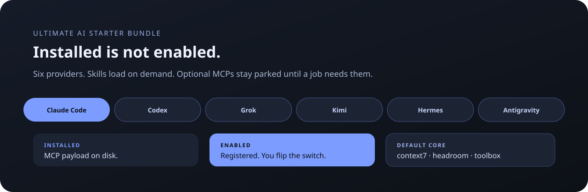

<!-- Ultimate AI Starter Bundle v8.37.7 -->

<p align="center">
  
</p>

<div align="center">

# Ultimate AI Starter Bundle v8.37.7

**Multi-provider AI starter kit. Not a Skyrim-only pack.**

Skills, MCP servers, plugins, and offline tools for Claude Code, Codex, Grok,
Kimi, Hermes and Google Antigravity: what an AI can do, what has been proved to
work, and which tool or forge owns each job. Game-specific depth lives in the
owner's forges (Skyrim, Risk of Rain 2, Roblox, Minecraft, RimWorld, Saints Row).

<p>
  <a href="https://github.com/SenjuWoo/Ultimate-AI-Starter-Bundle/actions/workflows/ci.yml"></a>
  <a href="LICENSE"></a>
  <a href="VERSION.txt"></a>
  <a href="https://github.com/SenjuWoo/Ultimate-AI-Starter-Bundle/releases/latest"></a>
</p>

<p>
  <a href="#start-here">Start here</a>
  ·
  <a href="#the-foundation-and-what-stands-on-it">The stack</a>
  ·
  <a href="#self-maintaining">Self-maintaining</a>
  ·
  <a href="docs/GUIDE.md">Reference guide</a>
  ·
  <a href="CHANGELOG.md">Changelog</a>
</p>

</div>

<p align="center">
  
</p>

## Start here

**What it is:** a one-click setup for AI coding apps on Windows. Claude Code,
Codex, Grok, Kimi, Hermes and Google Antigravity get the same skills, tools and
instructions, and learn where your games, mods and tools live.

**Three layers, use any combination:**

| Layer | Gives you | Turn it on |
|---|---|---|
| This bundle (base) | general skills, work hygiene, GitHub/CI, visuals, efficiency, compiling, base MCPs and tools | default |
| Reverse THIS! | optional reverse-engineering workbench: Ghidra, Frida, decompilers, REA | automatic when its kit is found |
| Skyrim Forge | optional Skyrim tools, its 48-skill pack and houseCARL | automatic when Skyrim or Forge is found |

The bundle owns the base and never installs a second copy of an owner's tools.
Each optional layer is detected through its own receipt, updated by its own
installer, skipped when the installed copy is current or newer, and left intact
when you turn the pack off. `-Packs` forces a layer on, `-ExcludePacks` keeps it
off, and both choices are remembered.

The base also ships a mod workspace doctor and a presentation gate:
`mod-workspace-organization` separates source, package, release and state and
repairs only unreferenced clutter; `mod-presentation` requires a real cover,
three gallery stills, README images with alt text and a kind-specific shot
before a public page ships.

**What you need:** Windows 10 or 11, an internet connection and at least one of
those apps. The default install also adds a compiler suite that can take several
GB; `-SkipBuildTools` skips it.

**Install in three steps**

1. Download the **Core** zip from the
   [latest release](https://github.com/SenjuWoo/Ultimate-AI-Starter-Bundle/releases/latest)
   and unzip it. On a slow or restricted network take **Full-Offline** instead;
   both install the same tools (see the table below).
2. Double-click **`START-HERE.bat`**. If Windows warns about the file, choose
   *Run* (or *More info*, then *Run anyway*); allow administrator rights if asked.
3. When the window says **INSTALL COMPLETE**, close and reopen your AI apps.

Then tell your AI what you want to build or mod; it starts the project tools a
task needs by itself.

| Release file | Pick it when |
|---|---|
| `…-Core.zip` | Ordinary connected install (~34 MiB). The installer fetches the bundled payloads from GitHub; same result as Full-Offline. |
| `…-Full-Offline.zip` | You want one file for an unreliable or restricted network (~128 MiB). It carries the tool payload snapshots, **not** an offline model: inference still needs your provider or a local server. |
| everything else | Checksums, build receipt, SBOM and CI results proving the zip is the one CI built. Not needed to install. |

**After installing**

| You want to | Do this |
|---|---|
| Update | Double-click `START-HERE.bat` again; it installs a newer release first and keeps your settings. |
| Add the Skyrim modding pack | nothing: it installs when Skyrim or Forge is found. Skip it with `-ExcludePacks skyrim`; force it with `-Packs skyrim`. |
| Add reverse-engineering tools | nothing: it installs when Reverse THIS! is registered. Force it with `-Packs reverse`. |
| Set up only some apps | `START-HERE.bat -Providers Claude,Codex` |
| Check the install | Run `START-HERE.bat` again; its last step checks everything and prints PASS or the problem. |
| Fix a failed install | See [Troubleshooting](#troubleshooting). |

Your own settings, instructions and model choices are kept, and config files are
backed up before any change. There is no one-click uninstaller yet.

Starting a task or resuming after a usage limit? Copy one of the
[short cross-provider prompts](PROMPTS/START-AND-RESUME.md), then add your task.
They emphasize relevant tools, preserved edits and verified completion without
repeating the installed contract or loading every MCP.

---

## The foundation, and what stands on it

Three kinds of thing live on this machine, and each one has exactly one owner.

| Layer | Owns | Kept current by |
|---|---|---|
| **This bundle** | general skills, work hygiene, GitHub/CI, UI review, efficiency, compilers, the MCP core, discovery | its own releases and CI |
| **Owner tools** | one game or one discipline each: Skyrim, Reverse THIS!, the game forges, CLI-Anything, the editor bridges | their own repositories and release cycles |
| **Split-out projects** | work that outgrew the foundation: the image-generation stack, the img2threejs tool tree | their own repositories |

The bundle installs the base, detects the rest, and reports where each owner tool
lives. It never installs a second copy, never rewrites an owner's files, and a
moved folder is found again instead of being redeclared missing.

### Owner tools this foundation is built to serve

| Tool | What it owns | Repository |
|---|---|---|
| **Skyrim Forge** | Skyrim SE/AE modding: records, Papyrus, FOMOD packaging, load order, houseCARL setup | [SenjuWoo/SkyrimForge](https://github.com/SenjuWoo/SkyrimForge) |
| **Reverse THIS!** | the reverse-engineering bench: Ghidra, Frida, x64dbg, decompilers, REA, verified tool payloads | [SenjuWoo/reverse-this](https://github.com/SenjuWoo/reverse-this) |
| **Risk of Rain 2 Forge** | Risk of Rain 2 mods, its own skill pack and tooling | [SenjuWoo/Risk-Of-Rain-2-Forge](https://github.com/SenjuWoo/Risk-Of-Rain-2-Forge) |
| **RobloxForge** | Roblox/Luau project work, Studio automation, its MCP server | [SenjuWoo/RobloxForge](https://github.com/SenjuWoo/RobloxForge) |
| **Minecraft Forge** | Minecraft mod and datapack work | [SenjuWoo/Minecraft-Forge](https://github.com/SenjuWoo/Minecraft-Forge) |
| **RimWorldForge** | RimWorld 1.6 XML/C# mods, packaging and validation | [SenjuWoo/RimWorldForge](https://github.com/SenjuWoo/RimWorldForge) |
| **Discord-Forge** | small Discord automations (a scam-image watcher and a tooling bot) | local workspace, no remote |
| **CLI-Anything** | an optional hub of per-app agent CLIs: Blender, GIMP, Godot, ComfyUI, browsers | [HKUDS/CLI-Anything](https://github.com/HKUDS/CLI-Anything) |
| **Unity MCP (Coplay)** | a Unity editor bridge used by the `unity` and `creative` profiles | [CoplayDev/unity-mcp](https://github.com/CoplayDev/unity-mcp) |
| **Unity MCP (IvanMurzak)** | an alternative Unity bridge with its own CLI and installer | [IvanMurzak/Unity-MCP](https://github.com/IvanMurzak/Unity-MCP) |
| **REA** | "Reverse Engineer Anything" CLI; pinned and installed by Reverse THIS! | [morluto/rea](https://github.com/morluto/rea) |
| **Context Mode** | context-shaping experiments and a marketplace plugin | [mksglu/context-mode](https://github.com/mksglu/context-mode) |
| **CLibDT** | a Skyrim mod-development toolkit (single executable, GPL-3) | upstream release |
| **Blender (portable)** | the editor a Blender MCP drives; kept beside the tools, not inside the bundle | [blender.org](https://www.blender.org/download/) |
| **Nx / Turbo / Vite / Webpack sources** | reference checkouts of the JS build tooling, read when a build question needs the source | upstream projects |

None of these are redistributed here. The bundle supplies what they all need:
one shared Python, compiler toolchains, discovery, skills and verification. Use
`UABS_TOOL_ROOTS` to tell every tool where the others are.

### Where tools live

Discovery reads, in order: `UABS_TOOL_ROOTS` (a semicolon-separated list), the
machine map the installer writes (`%USERPROFILE%/.uabs/profile/MACHINE-MAP.md`),
then the conventional per-user tool folders. Every lookup is depth-limited and
requires a unique match, so one moved folder is followed and two candidates are
reported instead of guessed. Move anything you like; nothing needs editing.

### Split out, not lost

| Moved out | Why | Where it lives now |
|---|---|---|
| Companion owners (Forge family, Reverse THIS!, comfy-kit, GUI apps) | `python TOOLS/companion_registry.py --verify` lists each owner as NOT_FOUND / DISCOVERED / INSTALLED_UNVERIFIED |
| Image-generation stack (SwarmUI/ComfyUI presets, Anima pin) | it is an image pipeline, not an agent harness, and it changes on model timescales | its own repository (`SenjuWoo/comfy-kit`) |
| `img2threejs` tool tree (489 files) | the capability belongs here, the tree does not | [img2threejs/img2threejs](https://github.com/img2threejs/img2threejs); the bundle keeps a pinned pointer skill |
| WooMix-Anima model page and samples | model publication, not harness work | the model's own workspace |

`impeccable` stays in full: UI review is harness work.

### The plan is executable

Every project template carries `PLAN.md` (task table with IDs, dependencies,
verification and evidence) and `STATE.md` (where you are right now). A small
deterministic controller reads both so a weaker model does not have to hold the
whole plan in context:

```
python TOOLS/task_state.py next      # first task whose dependencies are complete
python TOOLS/task_state.py status    # counts, cycle, complete-without-evidence, stale SHA
python TOOLS/task_state.py resume    # reconcile STATE.md with the plan and git (--fix writes it)
python TOOLS/task_state.py handoff   # compact continuation packet, ~10 lines
```

It parses, compares and runs nothing generative: no database, no daemon, no
network. A cycle, a duplicate ID or a task marked complete whose evidence file is
missing exits 1 instead of being silently believed.

## What the foundation gives you

| You get | What it is | When it costs tokens |
|---|---|---|
| **81 general skills per AI** | portable procedures: planning, review, debugging, modding routes, publishing, research | only the skills a task loads |
| **Native plugins** | Superpowers (process discipline) and Ponytail (smallest working change) | their own budgets; copies are deduped |
| **MCP core** | `context7`, `headroom`, `toolbox` everywhere; code-intel (`codebase-memory-mcp` + Serena) in the code profile | always-on core ~1.3k schema tokens; code-intel ~6.3k of a 10k ceiling |
| **Compilers** | Go, Rust, GCC, .NET, CMake/Ninja, Xmake, MSVC and the Windows SDK | disk, not context |
| **Verification** | completeness and assumption gates, RTK routing, a pack gate and an installed-state doctor | a few hundred tokens, only on tool calls |
| **Free asset routes** | open-source runtimes and local generators for a new game or app | nothing until used |

## Models: cheap worker, smarter planner

The starter ships **`deepseek/deepseek-v4.1-flash-1017`** as the only model:
one strong worker instead of a cheap aggregator plus a planner. It is a 552B MoE
(8B active on input, 16B on output), 1M context, native tool calling, and its
compressed KV cache is roughly a quarter of the previous Flash generation — that
is what makes long agent runs affordable. Prices, providers and quantizations:
<https://openrouter.ai/deepseek/deepseek-v4.1-flash-1017>

MoA presets are still defined but **disabled**: the Particle-1 aggregator was the
unreliable part, and a single model finishes more work per dollar. Re-enable with
`moa.presets.deepseek_particle.enabled` if you want it.

`provider_routing` sorts by price with `require_parameters: true`, so OpenRouter
routes to the cheapest provider that can actually run the tools. No provider list
is hardcoded: prices move weekly. When you want to pin the cheapest **cache-read**
providers instead, generate the list from live data:

```
python TOOLS/refresh-provider-routing.py                 # print the current list
python TOOLS/refresh-provider-routing.py --write %LOCALAPPDATA%\hermes\config.yaml
```

It reads the model's endpoints API, skips fp4/int4 endpoints, and writes
`provider_routing.only` for you. Nothing runs it automatically.
There is **no fallback chain**: a silent downgrade is worse than a clear error.

| Alias | Model | Use it for |
|---|---|---|
| *(default)* | `deepseek/deepseek-v4.1-flash-1017` | everything: coding, agents, long runs |
| `hermes model v4.1-flash` | `deepseek/deepseek-v4.1-flash` | the same family, non-pinned snapshot |
| `hermes model flash` | `deepseek/deepseek-v4-flash-0731` | fast, cheap passes |
| `hermes model v4-pro` | `deepseek/deepseek-v4-pro-0813` | hardest reasoning |
| `hermes model nemotron-ultra` | `nvidia/nemotron-3-ultra-550b-a55b:free` | free tier |
| `hermes model nemotron-ultra-nofree` | the same model, paid route | when the free tier is saturated |
| `hermes model muse` | `meta/muse-spark-1.2-contributor` | alternative voice |
| `hermes model gemini-flash` | `google/gemini-3.7-flash` | long-context browsing |
| `hermes model glm` | `z-ai/glm-5.3` | multilingual |
| `hermes model grok` | `x-ai/grok-4.6` | current-events reasoning |
| `hermes model sol` | `openai/gpt-5.6-sol` | when you choose to pay for it |
| `hermes model opus` | `anthropic/claude-opus-5` | when you choose to pay for it |
| `local` | whatever your LM Studio serves | you configure it; the portable starter never ships it |

Dated prices and the 320k worked example: [docs/HERMES-MODELS.md](docs/HERMES-MODELS.md).
Nothing is selected automatically beyond the two defaults, and existing model
choices are preserved.

## Self-maintaining

| Runs by itself | What it does |
|---|---|
| **Release self-update** | `START-HERE.bat` checks GitHub first, installs a newer release, keeps your settings |
| **Leftover cleanup** | removes pack-created backups past the last 3, logs past the last 5, and retired skills that carry the installer's ownership receipt and still match its recorded digest. Anything owned by another tool, edited since it was installed, or with no receipt at all is reported and left alone. `-SkipCleanup` keeps everything |
| **MCP path repair** | follows a tool that moved to a different folder tree, repairs the provider config, and requires a unique match |
| **Discovery** | reports `VERIFIED` only after the tool answers its own version/help call; a shim on PATH is `INSTALLED`, never "works" |
| **Installed-state doctor** | re-hashes the files each install receipt binds, checks the rest for presence, reports PASS or the exact problem |
| **Weekly companion check** | CI installs the latest Skyrim Forge and Reverse THIS! releases so a breaking upstream release shows up here first |

| Task | Command |
|---|---|
| Update everything | `START-HERE.bat` |
| Preview what would be cleaned | `powershell -File TOOLS/Clean-StaleState.ps1` |
| Clean now | `powershell -File TOOLS/Clean-StaleState.ps1 -Apply` |
| Repair moved MCP paths | `powershell -File TOOLS/Repair-McpPaths.ps1 -Apply` |
| Verify this machine | `powershell -File TOOLS/Test-Installed-State.ps1` |
| Verify the source tree | `powershell -File TOOLS/Verify-Fast.ps1` |
| See what is installed, truthfully | `powershell -File TOOLS/discover_tools.ps1` |

## Cost and speed

- Prompt caching (1 h TTL) is on; the planner is invoked on demand, not per turn.
- Compression caps are 320k to trigger and 80k to prune; your own values are never overwritten.
- RTK routes only what is safe (standalone `git status`, plain test runs); diffs, logs and searches stay raw.
- Plugin tool schemas are budgeted: a profile loads the MCP servers its work needs, not every server installed.
- Title generation and background review are off by default.
- Free and local routes exist for the whole toolchain: no paid component is required for core work.

## Verified, not claimed

A `PASS` means a real command ran and its exit status was checked, not that a file
exists. The pack gate checks skill trees, PowerShell parsing, offline hashes,
profile writers and upgrade fixtures; the doctor checks the machine; the release
pipeline builds twice and requires identical bytes before publishing.

Known limits are listed [below](#known-limitations) and in the
[reference guide](docs/GUIDE.md#validation-and-diagnostics). Source validation is
not runtime proof: parsing, packaging and a protocol handshake do not prove
gameplay, editor behavior or paid inference quality.

## Docs

| Document | Contents |
|---|---|
| [Reference guide](docs/GUIDE.md) | every install switch, provider wiring, what gets installed, troubleshooting |
| [Hermes models](docs/HERMES-MODELS.md) | dated prices, aliases, compression and caching |
| [Tool evaluations](docs/TOOL-EVALUATIONS.md) | what was evaluated, what was rejected, and why |
| [Decisions](docs/decisions/) | the architecture decisions this repository is held to |
| [Changelog](CHANGELOG.md) | release history |
| [Tool notices](BUNDLED-TOOLS/THIRD-PARTY-NOTICES.md) / [skill notices](_CANONICAL-SKILLS/THIRD-PARTY-NOTICES.md) | licences and attribution |

<a id="ownership"></a>

## Reference

Straight from the pack, kept here because these facts are load-bearing. Each
block is collapsed to keep the page readable.

<details>
<summary><strong>Skill listing budget (Claude Code)</strong></summary>

The starter sets `"skillListingBudgetFraction": 0.03`, which raises Claude
Code's listing budget above its 1% default so every skill name keeps its
description. It raises a ceiling only; it does not change which skills load.

### Profiles do not expire automatically

An explicitly enabled project profile stays configured until disabled.
Project scope, Hermes profile selection and provider trust still apply.
Filtering, caching and calls determine usage; a configured schema is not a
measured per-turn bill.

```powershell
.\TOOLS\Set-McpProfile.ps1 -List
.\TOOLS\Set-McpProfile.ps1 -Detect -Path "<project folder>"
.\TOOLS\Set-McpProfile.ps1 -Auto -Path "<project folder>"
.\TOOLS\Set-McpProfile.ps1 -Disable code-intel -Path "<project folder>"
.\TOOLS\Set-McpProfile.ps1 -Park -CheckOnly      # task servers registered machine-wide, nothing written
.\TOOLS\Set-McpProfile.ps1 -Unpark melty -Path "<project folder>"
hermes -p code       # specialist graph-memory profile
hermes -p default    # return to the small core
```

Claude, Grok and trusted Codex projects use project-scoped registrations.
Hermes uses named profiles; Kimi needs explicit global opt-in for optional
servers. The [profile catalog](BUNDLED-TOOLS/PROFILES.json) and
[Hermes policy](1-TAILORED-PROVIDER-TREES/Hermes/profiles/README.md) describe
requirements. The agent must explain missing prerequisites and restart/trust
requirements instead of pretending an installed server is callable.

</details>

<details>
<summary><strong>Web search and the keyless ring</strong></summary>

### Hermes: native web search and keyless options

`web_search` / `web_extract` are Hermes tools, separate from the model provider's
web-search plugin. A local model can drive them, but search/extraction still
contacts the selected external backend; model tokens and paid backends can bill.

The bundle's historical keyless-ring measurements and quotas are recorded in
the [Hermes notes](1-TAILORED-PROVIDER-TREES/Hermes/README.txt); they are not a
current service guarantee. Backend availability depends on installed Hermes,
configuration and upstream quotas. Do not add a duplicate always-on web MCP
merely because a native search call failed.

For a backstop that depends on no vendor account at all, add DuckDuckGo:

```powershell
& "$env:LOCALAPPDATA\hermes\hermes-agent\venv\Scripts\python.exe" -m pip install ddgs
```

Hermes ships the backend already; the package is the only missing piece. Pin it
with `web.search_backend: ddgs` **only** if the free ring gets flaky -- pinning
turns the rotation off.

</details>

<details>
<summary><strong>Running a local model without burning a quota</strong></summary>

### Hermes: run a local model, free and off the record

`lmstudio` is a first-class Hermes provider. Point an alias at a model LM Studio
is serving and switch to it with `hermes model local`:

```yaml
model_aliases:
  local:
    model: <the id LM Studio reports at /v1/models>
    provider: lmstudio
    base_url: http://127.0.0.1:1234/v1
```

No API key: Hermes supplies its own placeholder, because there is nothing to
authenticate to. Never write a real secret into an `lmstudio` block.

**Use 65,536 for the bundle's tested LM Studio setup**, then verify the saved
model-load settings and the context actually loaded. Hermes' normal local
floor is 64,000; a one-off load flag does not prove the saved default.
Weights, KV cache and desktop VRAM must fit: use [the budget/settings tools](BUNDLED-TOOLS/lm-studio/README.md)
instead of assuming a 16 GB card can run any model at that context.

Local inference stays on the selected server. Hosted auxiliary models, web
backends or fallbacks can still send data elsewhere; a local main model alone
does not make the entire harness local-only. [Local-model operations](_CANONICAL-SKILLS/local-model-ops/SKILL.md)
covers dynamic model IDs, load verification and performance diagnosis.

**Feeding a chat front-end from the same server?** SillyTavern is happy at 32K,
so 65,536 keeps one loaded model serving both. Two of its behaviours look like
a dead connection and are not: it demands a non-empty API key that a local
server ignores entirely, and a reasoning model returns an **empty** message
when Response Length is small, because thinking tokens come out of the same
budget (measured: 40 tokens in, empty reply; 600 in, 191 of 203 spent
reasoning). It also has no free web-search backend out of the box. All three
are covered in `local-model-ops/references/sillytavern.md`.

</details>

<details>
<summary><strong>RTK and claude-mem: what is on, what is off</strong></summary>

### rtk: cut command output before it reaches the model

Installed by default with a **bundle-owned narrow hook**; RTK's broad upstream
hook remains disabled. [RTK](https://github.com/rtk-ai/rtk) (Apache-2.0, single
Rust binary) filters noisy dev commands. Measured here
**at rtk 1.1.0** (Apache-2.0 OSS edition) against **pinned tag ranges**, so the corpus cannot drift:

| Command | Raw | Through rtk | Saved |
|---|---|---|---|
| `git log v8.6.1..v8.6.5` | 14,250 B | 1,660 B | **88%** |
| `git diff v8.6.1..v8.6.5` | 430,285 B | 55,870 B | **87%** |
| `git diff v8.6.4..v8.6.5` | 33,453 B | 26,820 B | **20%** |
| `git log --stat -20 v8.6.5` | 102,301 B | 102,301 B | **0%** |

**0% to 88%, depending entirely on the command.** A single headline number for
this tool is not honest -- an earlier version of this table quoted 97% from
`git diff HEAD~3`, which moves with every commit and measures 82.5% today.

**Pin the tool version too, not just the corpus.** That last row used to read
**95%**, measured at rtk 0.45.0. Upgrading to 0.46.0 dropped it to zero, and
1.0.0 still passes `--stat` straight through. All four rows were remeasured
on 2026-10-13; these are output bytes, not billed token savings. The old `git log --stat -20`
row also moved with HEAD despite the rest of the table being pinned; it now
ends at `v8.6.5`. Pinning only the corpus or only the tool is insufficient.

It is a CLI, so it adds no standing MCP schema. Instructions and command output
still consume context. The bundle selects the Apache-2.0 OSS build explicitly;
upstream's default 1.0 binary has different licensing. Pipelines, proxy daemons
and broad upstream rewrite hooks remain off.

#### Off git, it is a different tool

Every number above is a git command, and so was every number this pack had ever
shipped for rtk. Its own pitch is loudest about build output, test runners and
logs, so those were measured too -- same repo, **stdout only**, at 0.46.0:

| Command | Raw | Through rtk | Saved | Fidelity |
|---|---|---|---|---|
| `rtk err <powershell pack gate>` | 5,746 B | 567 B | **90%** | subset |
| `rtk test <python suite, RED>` | 5,507 B | ~400 B | **93%** | failure kept |
| `rtk ls -la` | 811 B | 271 B | **67%** | rewritten |
| `rtk ls -R` (skill tree, 164 skills when measured) | 25,059 B | 19,129 B | **24%** | rewritten |
| `rtk grep -rn` | 17,588 B | 14,463 B | **18%** | **truncates** |
| `rtk wc -l` | 5,414 B | 5,003 B | **8%** | rewritten |
| `rtk read` (191 KB `.py`) | 191,795 B | 191,795 B | **0%** | byte-identical |
| `rtk json` (5,425-row array) | 1,121,123 B | 144 B | *100%* | **truncates** |

**Excluding the rows that truncate rather than compress, the non-git aggregate
is 7.4% -- against 85.2% on git.** rtk is a git tool that also ships filters.

Two traps in that table. `rtk json` returning 144 bytes from 1.1 MB is not
compression: it prints **one** array element and `... +5424 more`. And **stdout
only** matters -- rtk writes a 78-byte `No hook installed` nag to *stderr* on
every invocation, which inverts the ratio on small outputs. A 4,869-byte result
measured **-486%** until stderr was excluded.

**`rtk find` breaks on compound predicates, and upstream knows.** A simple
`rtk find TOOLS -name '*.ps1'` is fine -- 709 B to 565 B, 24 files, exit 0. Add
a compound predicate and it collapses:

```
$ rtk find . -name '*.ps1' -not -path './.git/*'     # stdout: 0 bytes, exit 1
/usr/bin/find: paths must precede expression: `INSTALL-REMOTE.ps1'
```

The August 2026 review recorded **ten-plus issues against `rtk find` alone** in
`rtk-ai/rtk`,
including four near-duplicate reports of exactly this (#2469, #2847, #3256,
#3458), silent omission of gitignored (#3656) and hidden (#3291) files, and
**#3410** -- the rewrite rule for `find` is *unconditional*, so
`find ... -delete` / `-exec` is captured and refused, **silently doing nothing
and breaking `&&` chains**. That last one is upstream's report, not measured
here.

`rtk find` also **reformats paths**: single-directory mode drops the directory
prefix (`Build-Release.ps1`, not `TOOLS/Build-Release.ps1`), and across
directories it regroups under a `10F 2D:` header. The saving is real and small;
the output is not a path list you can pipe.

**Correction: rtk does not always discard.** Earlier releases of this README and
the catalog said flatly that rtk keeps no archive. That holds for `rtk git`,
`rtk ls`, `rtk read`, `rtk json` and `rtk wc` -- verified, no tee file is
written. It is **false** for `rtk test`, which writes a *complete* tee log (all
96 result lines) to `%LOCALAPPDATA%\rtk\tee` and prints the path, and only
partly true of `rtk grep`, which tees 6,482 of 17,588 bytes in per-file chunks
**and prints the retrieval command inline** -- it cuts each file at 25 hits and
appends `+28 more in <file> [see remaining: tail -n +26 "<tee path>"]`, so that
truncation is recoverable rather than lost.

**Know what the filters drop**, because `-g` applies them to commands you did
not opt into. `rtk ls -la` removes **timestamps and owner** and rounds sizes
(`36.6K` for 37,481 B) -- it cannot answer when a file changed or how big it
exactly is, the two usual reasons to pass `-la`. `rtk grep` abbreviates middle
path segments to `TOOLS/.../hooks/assumption_gate.py`. `rtk find` strips or
regroups directory prefixes. In each case the saving is real and the output has
stopped being a value you can pipe.

#### Default safe routing

No flag is needed. A normal install adds the binary and the bundle's allowlist
hook. `-WithRtk` remains a harmless compatibility alias for old scripts. The
safe hook rewrites only commands whose shape and output were measured:

| You type | Bundle runs | Policy |
|---|---|---|
| `git status`, `git status --short`, `git status -s` | `rtk git status ...` | automatic; a staged/unstaged/deleted/renamed/Unicode/untracked fixture was line-identical 5/5 |
| standalone `pytest`, `cargo test`, `go test` | RTK's matching test filter | automatic only for human-facing terminal output |
| `git diff`, `git show`, `git log` | unchanged | raw; the large measured diff retained only 361 of 5,856 changed lines |
| `git add`, `git commit`, `git push` | unchanged | mutating Git is never wrapped |
| `find`, `rg`/`grep`, `cat`, `curl`, `gh` | unchanged | broken, lossy, zero-gain, or exact-body surfaces stay raw |
| JSON/JUnit/report output, pipes, redirects, compound commands | unchanged | machine-readable and composable output stays raw |
| `npm test`, `dotnet test`, `python x.py` | *not rewritten* | Outside the bundle's tested allowlist |

Claude, Grok and Hermes receive the executable hook. Codex and Kimi receive the
same narrow routing rule in their installed instructions. Codex supports native
hooks, but this bundle does not bypass trust or install its executable gates
there; stale bundle-owned native handlers are retired on upgrades. Unknown payloads, missing RTK, RTK
errors, unsupported commands, and an RTK version newer than the measured catalog
pin all fail open to the original command.

You can still invoke other filters deliberately:

```powershell
rtk git status
rtk err <command>
rtk test <test command>
```

Why not use RTK's broad hook or Hermes' `rtk-rewrite` plugin? The current rewrite
table catches lossy diff/log/show, broken compound `find`, `cat` at 0% gain,
truncating search, exact `curl`/`gh` output, and even `git add`/`commit`/`push`.
This pack recommends neither broad path. The bundle hook delegates to RTK only
after its own allowlist passes, so `exclude_commands` is not the safety boundary.
Telemetry is opt-in and stays off. `rtk gain` verifies recorded invocations; an
agent's self-report does not prove that a rewrite actually ran.

### claude-mem is opt-in

Ordinary default components use the automated installer; optional editor/cloud
integrations still need their prerequisites. claude-mem pulls in the Bun runtime,
runs a background worker daemon, and needs a Claude Code restart before its
tools appear -- three surprises for one double-click, so it moved behind a flag:

```powershell
.\INSTALL-AIO.ps1 -WithClaudeMem
```

</details>

<details>
<summary><strong>Every bundled component</strong></summary>

## Third-party components

This list includes redistributed code, fetched packages and catalog-only candidates.
**A listing does not mean installed or connected.** Evaluated versions, source
commits and compatibility holds belong in [CATALOG.json](BUNDLED-TOOLS/CATALOG.json).

| Catalog ID | Upstream project | Integration |
|---|---|---|
| `universal-modder` | [Universal Modder](https://github.com/rehan-remade/universal-modder) | Vendored CLI/source and routed guides; default install |
| `uabs-toolbox` | [UABS Toolbox](https://github.com/SenjuWoo/Ultimate-AI-Starter-Bundle) | Bundle-owned; always-on find/describe/call, starts project tools on demand |
| `housecarl` | [houseCARL](https://github.com/Avick3110/houseCARL) | Offline payload; game/profile scope |
| `codebase-memory` | [codebase-memory-mcp](https://github.com/DeusData/codebase-memory-mcp) | Offline payload; code profile |
| `headroom` | [Headroom](https://github.com/headroomlabs-ai/headroom) | Wheel/source; core MCP |
| `superpowers` | [Superpowers](https://github.com/obra/superpowers) | Vendored skills and native plugins |
| `ponytail` | [Ponytail](https://github.com/DietrichGebert/ponytail) | Vendored skills and native plugins |
| `codeburn` | [CodeBurn](https://github.com/getagentseal/codeburn) | Default on-demand CLI |
| `impeccable` | [Impeccable](https://github.com/pbakaus/impeccable) | Vendored skill/detector; separately pinned CLI |
| `code-review-skill` | [Code Review Skill](https://github.com/awesome-skills/code-review-skill) | Vendored canonical skill |
| `obsidian-skills` | [Obsidian Skills](https://github.com/kepano/obsidian-skills) | Vendored canonical skills; no duplicate plugin needed |
| `claude-mem` | [claude-mem](https://github.com/thedotmack/claude-mem) | Explicit -WithClaudeMem only |
| `playwright-mcp` | [Playwright MCP](https://github.com/microsoft/playwright-mcp) | Scoped browser MCP |
| `firecrawl-mcp` | [Firecrawl MCP](https://github.com/firecrawl/firecrawl-mcp-server) | Security-held; not installed/registered |
| `perplexity-mcp` | [Perplexity MCP](https://github.com/perplexityai/modelcontextprotocol) | Credential-gated MCP |
| `context7` | [Context7](https://github.com/upstash/context7) | Core documentation MCP |
| `github-mcp-server` | [GitHub MCP Server](https://github.com/github/github-mcp-server) | Official offline binary; core MCP |
| `serena` | [Serena](https://github.com/oraios/serena) | Code-intel / Hermes code profile; LSP navigation and symbol edits |
| `chrome-devtools-mcp` | [Chrome DevTools MCP](https://github.com/ChromeDevTools/chrome-devtools-mcp) | Scoped browser inspection |
| `shadcn-mcp` | [shadcn MCP](https://github.com/shadcn-ui/ui) | Matching project registry profile |
| `blender-mcp` | [Blender MCP](https://github.com/ahujasid/mcp-for-blender) | Editor profile; Blender/addon prerequisite |
| `godot-mcp` | [Godot MCP](https://github.com/Coding-Solo/godot-mcp) | Editor profile; Godot prerequisite |
| `unity-mcp` | [Unity MCP](https://github.com/IvanMurzak/Unity-MCP) | Project package/generated executable prerequisite |
| `rtk` | [RTK](https://github.com/rtk-ai/rtk) | Default CLI; narrow routing |
| `omni` | [OMNI](https://github.com/fajarhide/omni) | Catalog/evaluation only; not installed |
| `windows-mcp` | [Windows MCP](https://github.com/CursorTouch/Windows-MCP) | Manual opt-in; OFF by default |
| `super-mcp-router` | [Super MCP Router](https://github.com/mindstone/Super-MCP) | Evaluated catalog entry; no default router wiring |
| `playwright-cli` | [Playwright CLI](https://github.com/microsoft/playwright-cli) | Default CLI; browser installation separate |
| `comfy-cli` | [ComfyUI CLI](https://github.com/Comfy-Org/comfy-cli) | Optional user-managed tool; not installed by default |
| `rea` | [REA](https://github.com/morluto/rea) | Optional pinned CLI; no global MCP or setup writes |
| `reverse-this` | [Reverse THIS!](https://github.com/SenjuWoo/reverse-this) | Optional standalone analysis workbench; source MIT, individual payload licenses apply |
| Reverse THIS! | [Reverse THIS!](https://github.com/SenjuWoo/reverse-this) | Reuses an existing discovered tool bench; no duplicate installation |
| CLI-Anything | [HKUDS/CLI-Anything](https://github.com/HKUDS/CLI-Anything) | Companion hub of per-app agent CLIs (Blender, FreeCAD, GIMP, Audacity, Godot, ComfyUI, browsers...). `pip install cli-anything-hub`, install the harnesses you need. Apache-2.0; v0.4.0 checked 2026-10-16. Not redistributed or installed by the pack. |
| anti-slop | [miqdadbadjuber/anti-slop](https://github.com/miqdadbadjuber/anti-slop) | MIT rules filter against generic AI UI, filler copy and AI-shaped code (`rules/antislop.md` plus a CLI). Overlaps the bundled `impeccable` and `humanizer` skills; use it as an extra filter. v3.2.21 checked 2026-10-16. |
| jevgrep | [dzhng/jevgrep](https://github.com/dzhng/jevgrep) | Hosted code-search CLI (`jg`) that answers repo questions through Jev and returns files plus verbatim excerpts; needs its own account. The bundled `codebase-memory-mcp` already answers that class of question locally. 0.8.0 checked 2026-10-16. |
| Caveman | [JuliusBrussee/caveman](https://github.com/JuliusBrussee/caveman) | Voice/input compression with its own multi-agent installer and an optional routing layer. **Conflicts with this bundle's wiring**: its installer writes the same `SOUL.md` / `AGENTS.md` / skills / hooks / `settings.json` files this pack owns, and its routing layers repoint `ANTHROPIC_BASE_URL`. Evaluated 4.0.1 (Apache-2.0) 2026-10-16 — documented, not installed; see [evaluations](docs/TOOL-EVALUATIONS.md). |
| OmniRoute | [diegosouzapw/OmniRoute](https://github.com/diegosouzapw/OmniRoute) | Local free-tier gateway for CLI agents (`localhost:20128/v1`, 13 `setup-*` commands, RTK + Caveman compression inside). **Conflicts with this bundle's invariants**: it takes over provider endpoints and depends on stacked third-party free tiers, which the bundled `token-efficiency` skill rules out as a default. Evaluated 3.8.51 (MIT) 2026-10-16 — documented, not installed. |

Additional canonical payloads without separate tool-catalog entries:

| Payload | Upstream | Integration |
|---|---|---|
| `img2threejs` | [img2threejs/img2threejs](https://github.com/img2threejs/img2threejs) | Pinned pointer skill (v1.5.1); the tool tree lives in its own repo |
| `skill-creator`, `build-mcp-server`, `build-mcpb`, `build-mcp-app` | [anthropics/claude-plugins-official](https://github.com/anthropics/claude-plugins-official) | Selected cross-provider skills, not the entire marketplace |
| Hermes native Unity bridge | [CoplayDev/unity-mcp](https://github.com/CoplayDev/unity-mcp) | Existing Coplay editor backend, isolated in `unity`/`creative`; distinct from the IvanMurzak project route |

Skyrim Forge is the bundle author's product, released from
[SenjuWoo/SkyrimForge](https://github.com/SenjuWoo/SkyrimForge); the installer takes its latest release, verified by digest.
[Tool notices](BUNDLED-TOOLS/THIRD-PARTY-NOTICES.md) and
[skill notices](_CANONICAL-SKILLS/THIRD-PARTY-NOTICES.md) retain licenses,
credits and adaptation notes. The pack's MIT license does not relicense these
projects. Preserve upstream attribution when redistributing.

<a id="ownership"></a>

</details>

## Ownership

This section is the one statement of who owns what; Skyrim Forge and Reverse THIS!
link here instead of restating it. Each repository develops, tests and releases on
its own. The bundle pins no companion version: CATALOG.json holds a minimum
version per companion, the installer takes the latest release at or above it
(verified against GitHub's sha256 digest and the release's SHA256SUMS), a newer
installed copy is kept, and CI installs the latest releases every week so a
breaking companion release shows up here without a bundle change.

| Owner | Owns | Release |
|---|---|---|
| Ultimate AI Starter Bundle | general AI tooling, the 81 general skills, provider instruction/MCP config, the toolbox, the shared runtime | `main` → CI → `release.yml` |
| [Skyrim Forge](https://github.com/SenjuWoo/SkyrimForge) | Skyrim tools and its skill pack, houseCARL setup, the `skyrim-forge` MCP | its own releases |
| [Reverse THIS!](https://github.com/SenjuWoo/reverse-this) | the RE tool bench, `sandbox/bin`, its tool selection | its own releases |
| Other forges ([Risk of Rain 2](https://github.com/SenjuWoo/Risk-Of-Rain-2-Forge), [Roblox](https://github.com/SenjuWoo/RobloxForge), [Minecraft](https://github.com/SenjuWoo/Minecraft-Forge), [RimWorld](https://github.com/SenjuWoo/RimWorldForge), [Saints Row](https://github.com/SenjuWoo/SaintsRowForge), [AvatarForge](https://github.com/SenjuWoo/AvatarForge)) | their game's skill, tools and knowledge; the bundle ships no second copy and routes to them from `ai-tooling-stack` | their own releases |

Where one repository reads what another writes, the contract is tested on both sides:

| Contract | Written by | Read by |
|---|---|---|
| `UABS_PYTHON` (shared base interpreter) | bundle (`TOOLS/Set-SharedPython.ps1`) | Forge, Reverse THIS! |
| `UABS_TOOL_ROOTS` (extra tool folders) | you, optionally | bundle, Forge, Reverse THIS! |
| `SKYRIM_FORGE_ROOT`, `forge doctor` JSON (`result`, `read_only_ready`) | Forge | bundle (`TOOLS/Install-SkyrimForge.ps1`) |
| `%LOCALAPPDATA%\ReverseThis\kit.json` | Reverse THIS! | bundle (`TOOLS/Install-ReverseThis.ps1`) |
| `%LOCALAPPDATA%\Ultimate-AI-Starter-Bundle\toolbox-profiles.json` | bundle installer | Forge's MCP registration, which defers to the toolbox |


## Known limitations

- A few large skills exceed the body-size budget; `TOOLS\audit_skills.py` names
  them. Their bodies load on demand, but that does not make them free.
- Claude Code's skill listing still drops the least-used descriptions on small
  context windows; `/doctor` shows the listing cost and `/skill-doctor` finds
  unused skills.
- **The knowledge graph cannot read Papyrus.** Use source search and
  `papyrus-reference` for `.psc`. The graph covers supported languages
  and repository structure, not live load-order truth.
- Compatibility holds are deliberate: a newer upstream release is not
  automatically a tested replacement. See the catalog and dated evaluations.
- Free model availability, quotas and prices change; the live provider
  catalog outranks a dated snapshot.
- Full-Offline carries payload snapshots, not every runtime or dependency cache.
  Fresh-home CI fixtures do not certify every clean Windows machine or account.
- Parsing, packaging and protocol handshakes do not prove actual gameplay,
  connected-editor behavior, paid inference quality or GPU performance.


## Version

The version is in [VERSION.txt](VERSION.txt). Every release, with its notes,
checksums, build receipt, SBOM and build attestation, is on the
[releases page](https://github.com/SenjuWoo/Ultimate-AI-Starter-Bundle/releases);
[CHANGELOG.md](CHANGELOG.md) and `docs/history/` hold the history.

## License

Original bundle code and documentation are [MIT-licensed](LICENSE).
Third-party payloads keep their own terms: see the [tool notices](BUNDLED-TOOLS/THIRD-PARTY-NOTICES.md)
and [skill notices](_CANONICAL-SKILLS/THIRD-PARTY-NOTICES.md).

## Project ownership and publication

Before substantive edits, agents create/read WORKSPACE_OWNERSHIP.md with the workspace-organization helper. WORKSPACE.md maps projects and STATE.md tracks progress. New work stays local until publication is requested. “Put it on GitHub” means public/MIT for original work by default, subject to rights/platform terms and existing licences. Skyrim publication normally targets Nexus; mods needing no compilation do not get duplicate GitHub hosting by default. Existing repository updates include authorized docs, push and release work.

Release ZIPs carry the product, runtime help/templates and required licensing. Source ledgers, changelogs, test suites and CI stay in the repository. Skyrim mod ZIPs contain runtime mod files; publication pages/audits stay beside the archive.
